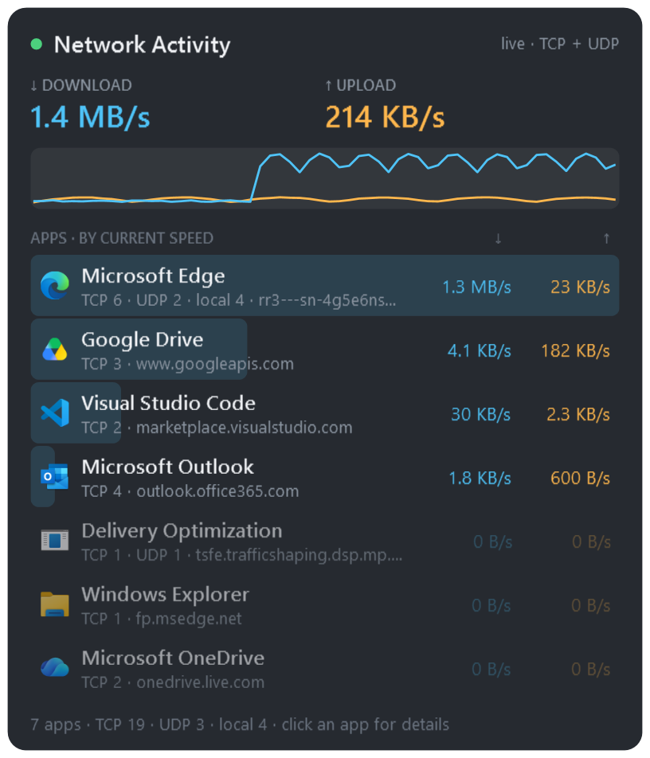
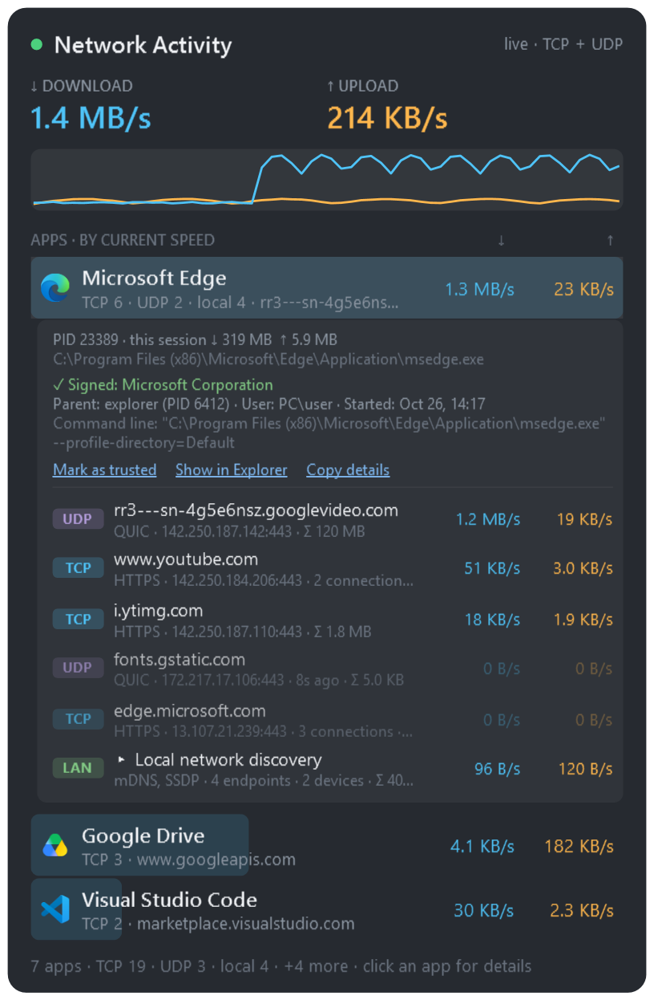
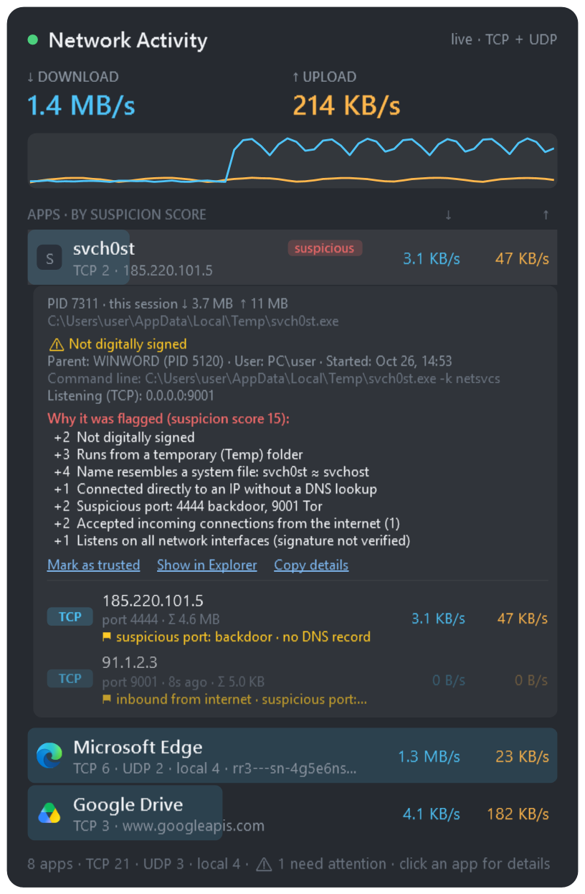
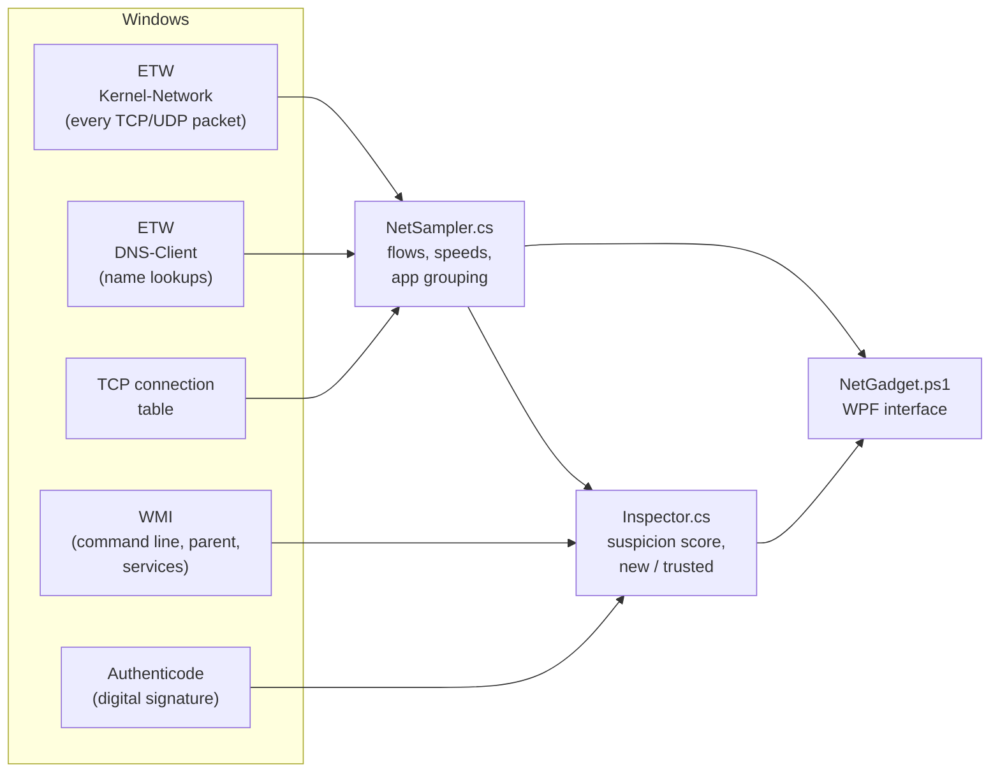

<div align="center">

# 🌐 NetGadget — Network Activity

**A Windows desktop gadget that shows live which apps on your computer send data to the internet, where, and how much.**


**English** · [Türkçe](README.tr.md)



</div>

---

## Why?

Task Manager shows your total network usage; Resource Monitor has the details but is clunky.
NetGadget sits in a corner of your desktop as a small window and answers every second:

- **Which apps** are connected to the internet right now, and how much are they downloading / uploading?
- **Where** are they connecting? (domain name, IP, port, protocol)
- Is there anything I **should be suspicious of**?

Nothing to install: it runs on the PowerShell 5.1 and .NET Framework that already ship with Windows, and no data
ever leaves your computer.

## Features

| | |
|---|---|
| 📊 **Live traffic** | Total ↓/↑ speed, a graph of the last 60 seconds, per-app current speed and session total |
| 🔌 **All connections** | TCP **and** UDP (QUIC/HTTP3, DNS, games, video calls), IPv4 **and** IPv6 |
| 🔎 **Details panel** | Click an app: domain, protocol, service (HTTPS, QUIC, DNS…), speed and total for every endpoint |
| 🏷️ **Domain names** | Learned in real time from DNS lookups; DNS-only reverse lookups for unknown internet IPs |
| 🏠 **Local network grouping** | Local announcements such as mDNS, SSDP, LLMNR and NetBIOS are folded into a single row |
| 🛡️ **Suspicious connection review** | Digital signature, run location, fake system file names, command line, parent process, IPs without DNS, suspicious ports, inbound connections → **suspicion score** |
| 🆕 **First seen** | Learns your normal traffic and flags apps and addresses never seen before |
| ✅ **Trusted list** | Mark apps and addresses you know to take them out of the warnings |
| 🌍 **Multilingual** | English and Turkish; picked automatically from the Windows language, switchable from the menu |
| ⚙️ **Gadget-like** | Borderless, translucent, draggable; always on top, tray icon, position and settings remembered |

<table>
<tr>
<td width="50%" valign="top">

**Details panel**<br>


</td>
<td width="50%" valign="top">

**Suspicious connection review**<br>


</td>
</tr>
</table>

> Screenshots were made with sample data.

## Requirements

- Windows 10 or Windows 11 (64-bit)
- Windows PowerShell 5.1 and .NET Framework 4.x — already installed with Windows
- **Administrator rights** (recommended) — needed to measure per-app traffic; without them it runs in limited mode

## Installation

**With Git:**

```bash
git clone https://github.com/kubikanber/netgadget.git
```

**or as a ZIP:** download the latest `NetGadget-vX.Y.Z.zip` from [Releases](https://github.com/kubikanber/netgadget/releases/latest)
(or **Code → Download ZIP**) and extract it to any folder.

> Windows marks files downloaded as a ZIP as "from the internet" and may warn when you run them.
> Open a PowerShell window in the folder and run this once:
>
> ```powershell
> Get-ChildItem -Recurse | Unblock-File
> ```

## Getting started

Double-click **`Baslat.cmd`** ("start"). Windows asks for administrator rights (UAC):

| Top-right shows | When | What you get |
|---|---|---|
| **live · TCP + UDP** | Administrator rights granted | Everything: per-app TCP/UDP speeds, domain names, all review features |
| **live · TCP only** | Administrator rights, but ETW could not start | Per-app TCP speeds only |
| **limited mode** | Administrator rights declined | Total speed, graph and apps with TCP connections (no per-app speed) |

**To start with Windows:** `Win + R` → `shell:startup` → put a shortcut to `Baslat.cmd` in the folder that opens.
You'll be asked for administrator rights at every start.

## Usage

### Main window

- **Top:** total download / upload speed and a graph of the last 60 seconds (blue ↓, orange ↑).
- **App list:** each row shows the app's icon, name, a connection summary (`TCP 6 · UDP 2 · local 4 · domain`)
  and its current speed. The blue bar behind it shows how much traffic the app has right now.
- **Badges:** 🔴 `suspicious` · 🟡 `attention` · 🔵 `new` · 🟢 `trusted`
- **Bottom line:** app and connection counts, number of apps needing attention, learning mode status.

### Details panel

**Click** an app:

- PIDs, total data transferred this session, file path, hosted Windows services (for svchost)
- **Digital signature** and signer, **parent process**, user, start time, **command line**, listening ports
- **Suspicion reasons** with their scores, if any
- Links: **Mark as trusted** · **Show in Explorer** · **Copy details** (full report to the clipboard)
- Endpoints: `TCP`/`UDP` tag, domain, service and address, speed, total; ⚑ flags if any
  (`suspicious port`, `no DNS record`, `inbound from internet`, `new`)
- **Local network discovery** row: click to expand the individual local announcements

**Right-click an endpoint** to copy its domain / IP or choose **Trust this endpoint**.

### Menu (right-click or tray icon)

| Option | Description |
|---|---|
| Show / Hide | Hides the window; double-click the tray icon to bring it back |
| Always on top | Keeps the window above other windows (default: on) |
| Show only apps transferring data | Hides apps with no traffic at the moment |
| **Sort by** | Current speed · Session total · Connections · Name (A–Z) · Suspicion score |
| Collapse all details | Closes all open details panels |
| **Name resolution** | *Reverse DNS for internet addresses* (default: on) · *Resolve local device names (NetBIOS/mDNS)* (default: off) |
| **Language / Dil** | *Automatic (Windows language)* · English · Türkçe — applied instantly and remembered |
| Exit | Closes the gadget |

Drag the window by its title or graph; its position is remembered.

## Suspicious connection review

Every app is scored with local checks. A total of **≥ 3** shows an `attention` badge, **≥ 5** a `suspicious` badge.
None of the checks connect to the internet.

| Sign | Score |
|---|:-:|
| Has a system file name but runs from another location (e.g. `D:\svchost.exe`) | +5 |
| Name resembles a system file (`svch0st`, `scvhost`) | +4 |
| Invalid / missing digital signature | +4 / +2 |
| Runs from Temp, the Recycle Bin, Public or PerfLogs | +3 – 4 |
| Runs from Downloads, the root of ProgramData or the root of AppData\Roaming | +2 |
| A system tool such as PowerShell, mshta, rundll32 or certutil connects to the internet | +2 |
| Suspicious command line for such a tool (`-enc`, `DownloadString`, `-w hidden`, a URL…) | +3 |
| Such a tool was started by an Office / PDF application | +3 |
| Backdoor / IRC / Tor / mining ports (4444, 6667, 9001, 3333…) | +2 |
| Accepts incoming connections from the internet | +2 |
| Connects directly to an IP without a DNS lookup | +1 |
| A program without a verified signature listens on all network interfaces | +1 |
| Connects to the internet for the first time | +1 |

- **Learning mode:** on the first run your normal traffic is recorded for 5 minutes and nothing is marked "new".
  After that, apps and addresses never seen before are marked `new` for 10 minutes.
- An app marked **trusted** has its score reset to zero; its signs are still shown but not counted.
  Endpoints are trusted per domain (or per /24 network of the IP).
- A score alone does not mean "malware"; it shows you where to look.
  For example, a browser's secure DNS (DoH) can trigger the `no DNS record` flag.

## Privacy

- **No data ever leaves your computer.** All measurements and checks are local.
- The only network traffic the gadget itself creates is reverse DNS lookups for **internet** IPs without a known
  name (very small; can be turned off in the menu). Local network devices are only queried if you enable it.
- Stored on your computer (`%APPDATA%\NetGadget`):

  | File | Contents |
  |---|---|
  | `settings.json` | Window position, language and menu choices |
  | `known.tsv` | Apps and addresses seen before (for "first seen") |
  | `trusted.tsv` | Trusted list |

  Deleting this folder resets all settings and the learned traffic.

## How does it work?



- **Traffic:** the `Microsoft-Windows-Kernel-Network` ETW provider — the same source Resource Monitor uses — reports
  every sent and received packet with its process ID. If ETW can't start, it falls back to TCP EStats counters, and
  without administrator rights to the TCP connection table only.
- **Domain names:** `Microsoft-Windows-DNS-Client` ETW events and the Windows DNS cache; if needed, a DNS-only
  reverse lookup (NetBIOS/mDNS off).
- **Review:** the digital signature is read with `Get-AuthenticodeSignature` and process details with WMI, in the
  background and cached.
- **Interface:** WPF; the C# code is compiled at runtime with `Add-Type`, there is no separate build step.
- **Languages:** all texts live in `lang\<language>.json` files (like `"menu.sort": "Sort by"`). Any text missing in a
  language falls back to English. See [CONTRIBUTING.md](CONTRIBUTING.md#yeni-dil-ekleme) to add a language.

## Troubleshooting

<details>
<summary><b>It says "limited mode" at the top right and shows no speeds</b></summary>

Administrator rights were not granted. Close the gadget, start it again with `Baslat.cmd` and choose **Yes** in the
UAC prompt.
</details>

<details>
<summary><b>It says "live · TCP only"</b></summary>

The ETW session could not be started; check the error code on the bottom line. It's usually a session left over from
a previous run and goes away after a restart. If not, run this in an administrator PowerShell:

```powershell
logman stop NetGadget-KernelNetwork -ets
```
</details>

<details>
<summary><b>Nothing happens when I double-click it</b></summary>

The gadget may already be running (only one instance runs at a time); double-click the tray icon.
If you downloaded a ZIP, do the `Unblock-File` step above. Antivirus software can block PowerShell from compiling
code; add the folder to its exclusions if needed.
</details>

<details>
<summary><b>Some addresses show an IP instead of a domain name</b></summary>

The app may resolve DNS itself and bypass Windows (a browser's "secure DNS"), the connection may have been made
before the gadget started, or the IP has no reverse DNS record.
</details>

<details>
<summary><b>The gadget opens in the wrong language</b></summary>

With the language set to "Automatic", the Windows display language is used. Right-click → **Language / Dil** and
pick a language; your choice is remembered.
</details>

<details>
<summary><b>Uninstalling</b></summary>

Close the gadget, delete its folder and, if you like, the `%APPDATA%\NetGadget` folder. Nothing is written anywhere else.
</details>

## Roadmap

### ✅ Phase 1 — Local checks (done)

- [x] Digital signature and signer
- [x] Run location and fake / look-alike system file names
- [x] Command line, parent process, user, start time
- [x] Connections to IPs without a DNS lookup
- [x] Inbound connections and listening ports
- [x] Suspicious ports (backdoor, IRC, Tor, mining)
- [x] "First seen" (with learning mode)
- [x] Suspicion score, badges and reasons
- [x] Trusted list (apps and endpoints)

### 🔜 Phase 2 — History and behavior

- [ ] **Persistent connection history:** which app, which endpoint, first / last seen, how much data — kept after the gadget closes
- [ ] **Beaconing detection:** small connections at clock-like intervals — the typical "phone home" pattern of backdoors
- [ ] **Upload / download ratio alert:** an app that normally downloads suddenly uploading a lot
- [ ] **Background activity:** windowless programs sending data while the computer is idle
- [ ] **Windows notifications:** when a new high-score connection appears
- [ ] **Watch list:** apps and addresses to keep a closer eye on
- [ ] **Investigation window:** a large, resizable window with Process, Connections, Timeline (per-app graph) and Endpoint tabs

### 🔭 Phase 3 — External sources and response

All optional and only with your explicit consent.

- [ ] **Country and hosting provider (ASN):** from an offline database — IPs are never sent anywhere
- [ ] **Local blocklists:** matched on your computer against lists such as abuse.ch Feodo Tracker and Spamhaus DROP
- [ ] **Reputation lookups:** VirusTotal / AbuseIPDB (off by default, API key required)
- [ ] **File fingerprint (SHA-256)** with a VirusTotal search link
- [ ] **Blocking with Windows Firewall:** per app or IP, reversible
- [ ] **Packet capture:** a short capture of the selected app / IP only, with Windows' built-in `pktmon` (opens in Wireshark; includes the TLS SNI that shows which site HTTPS goes to)
- [ ] **Report export:** HTML / CSV

Use [Issues](https://github.com/kubikanber/netgadget/issues) for suggestions and bug reports.
Please report security vulnerabilities privately as described in [SECURITY.md](SECURITY.md).
Contributing: [CONTRIBUTING.md](CONTRIBUTING.md); release history: [CHANGELOG.md](CHANGELOG.md)
(these documents are currently in Turkish).

## Limitations

- The **content** of encrypted traffic (HTTPS/QUIC) is not visible; what you see is who sends how much data, where and when.
- Non-TCP/UDP traffic such as ICMP (ping) is included in the totals but not attributed to apps.
- Finished UDP endpoints and closed TCP connections stay in the list for 30 more seconds.
- Local (loopback) traffic is not listed.

## Files

| File | Description |
|---|---|
| `Baslat.cmd` | Launcher |
| `NetGadget.ps1` | Interface, menu, settings |
| `NetSampler.cs` | ETW, connection tables, domain names, app grouping |
| `Inspector.cs` | Signature, process details, suspicion score, "first seen", trusted list |
| `lang/` | Interface languages (`en.json`, `tr.json`) |
| `tools/Test-Translations.ps1` | Checks language files for missing / unused keys |
| `docs/images/` | README screenshots (`en/`, `tr/`) |
| `CHANGELOG.md` · `CONTRIBUTING.md` · `SECURITY.md` | Release history, contributing guide, security policy |

## License

[MIT](LICENSE) © 2026 kubikanber
