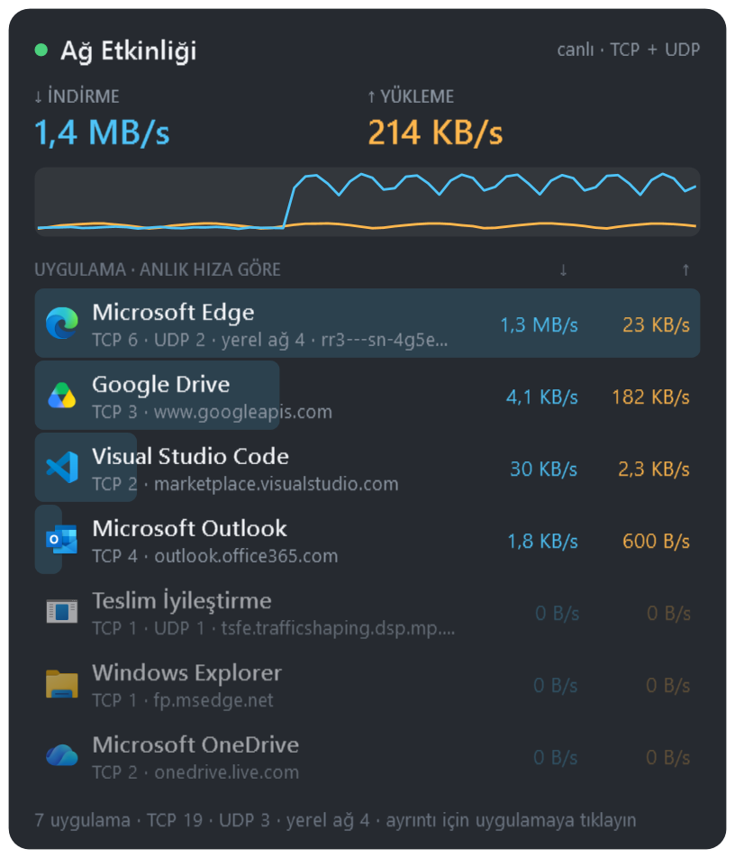
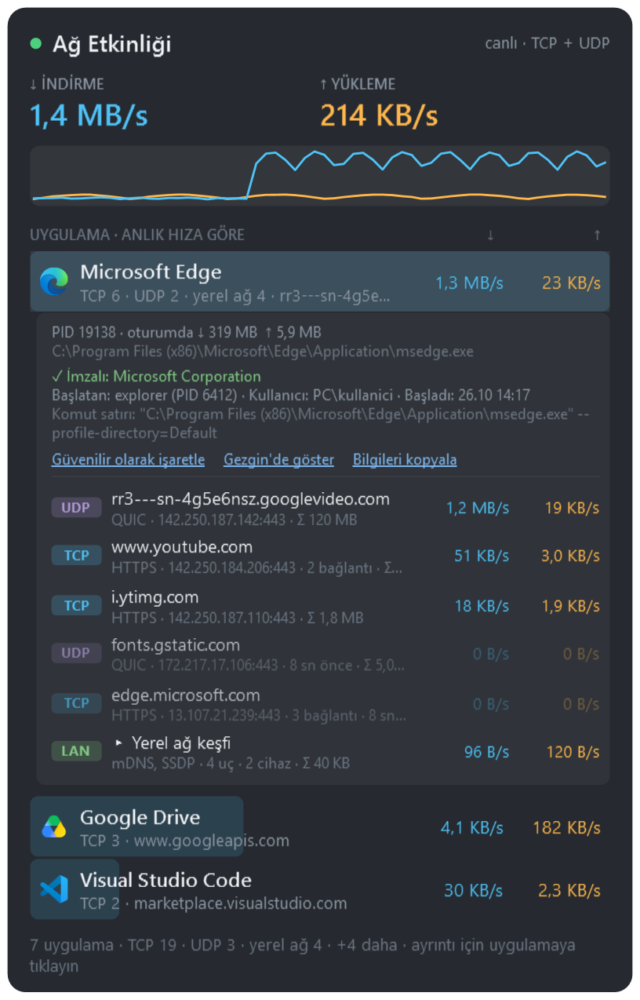
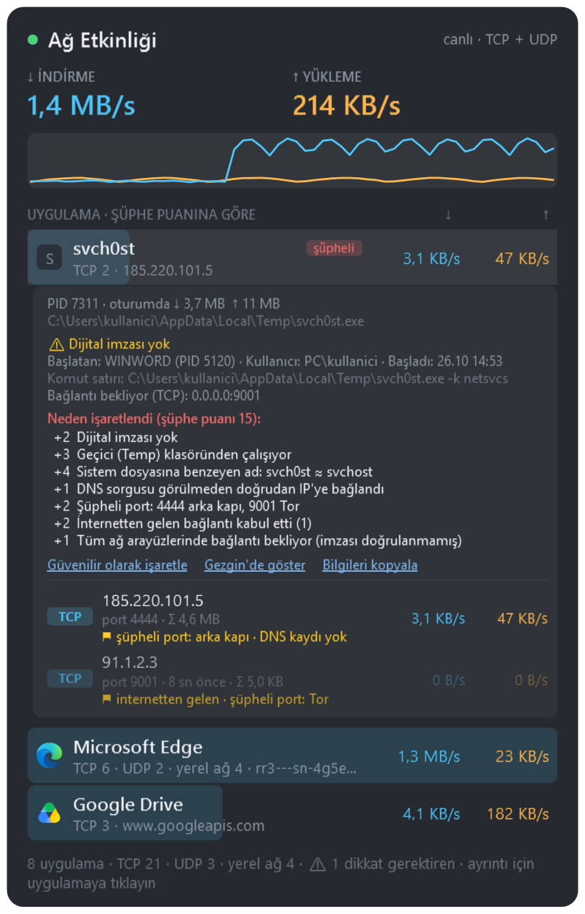
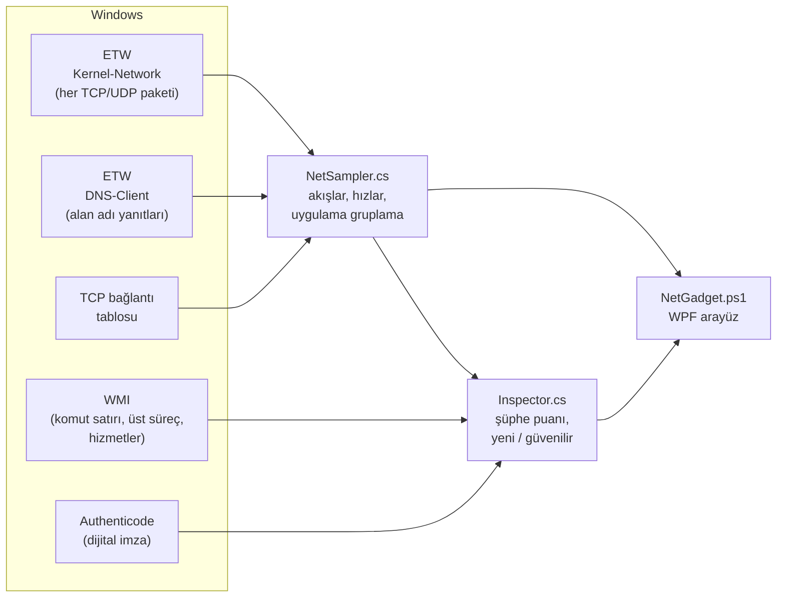

<div align="center">

# 🌐 Ağ Etkinliği — NetGadget

**Bilgisayarınızda internete kimin, nereye, ne kadar veri gönderdiğini canlı gösteren Windows masaüstü gadget'ı.**


[English](README.md) · **Türkçe**



</div>

---

## Neden?

Windows'un Görev Yöneticisi toplam ağ kullanımını gösterir, Kaynak İzleyicisi ise ayrıntılı ama hantaldır.
NetGadget masaüstünüzün köşesinde küçük bir pencere olarak durur ve her saniye şunları cevaplar:

- **Hangi uygulamalar** şu an internete bağlı ve ne kadar veri indiriyor / yüklüyor?
- **Nereye** bağlanıyorlar? (alan adı, IP, port, protokol)
- Bu bağlantılardan **şüphelenmem gereken** var mı?

Kurulum gerektirmez: Windows'ta zaten bulunan PowerShell 5.1 ve .NET Framework ile çalışır, hiçbir veri
bilgisayarınızın dışına gönderilmez.

## Özellikler

| | |
|---|---|
| 📊 **Canlı trafik** | Toplam ↓/↑ hız, son 60 saniyenin grafiği, uygulama başına anlık hız ve oturum toplamı |
| 🔌 **Tüm bağlantılar** | TCP **ve** UDP (QUIC/HTTP3, DNS, oyunlar, görüntülü aramalar), IPv4 **ve** IPv6 |
| 🔎 **Ayrıntı paneli** | Uygulamaya tıklayın: bağlandığı her uç nokta için alan adı, protokol, hizmet (HTTPS, QUIC, DNS…), hız ve toplam |
| 🏷️ **Alan adları** | DNS sorgularından gerçek zamanlı öğrenilir; bilinmeyen internet IP'leri için yalnızca DNS ile ters sorgu |
| 🏠 **Yerel ağ gruplaması** | mDNS, SSDP, LLMNR, NetBIOS gibi yerel ağ duyuruları tek satırda toplanır |
| 🛡️ **Şüpheli bağlantı incelemesi** | Dijital imza, çalıştığı klasör, sahte sistem dosyası adları, komut satırı, başlatan süreç, DNS'siz IP, şüpheli portlar, gelen bağlantılar → **şüphe puanı** |
| 🆕 **İlk kez görüldü** | Normal trafiğinizi öğrenir; daha önce hiç görülmemiş uygulama ve adresleri işaretler |
| ✅ **Güvenilir listesi** | Bildiğiniz uygulama ve adresleri işaretleyip uyarılardan çıkarın |
| 🌍 **Çoklu dil** | Türkçe ve İngilizce; Windows diline göre otomatik seçilir, menüden anında değiştirilir |
| ⚙️ **Gadget gibi** | Kenarlıksız, yarı saydam, sürüklenebilir; her zaman üstte, tepsi simgesi, konum ve ayarlar hatırlanır |

<table>
<tr>
<td width="50%" valign="top">

**Ayrıntı paneli**<br>


</td>
<td width="50%" valign="top">

**Şüpheli bağlantı incelemesi**<br>


</td>
</tr>
</table>

> Ekran görüntüleri örnek verilerle hazırlanmıştır.

## Gereksinimler

- Windows 10 veya Windows 11 (64 bit)
- Windows PowerShell 5.1 ve .NET Framework 4.x — Windows'ta zaten yüklüdür
- **Yönetici izni** (önerilir) — uygulama başına trafik ölçümü için gerekir; izin verilmezse sınırlı modda çalışır

## Kurulum

**Git ile:**

```bash
git clone https://github.com/kubikanber/netgadget.git
```

**ya da ZIP olarak:** sayfanın üstündeki **Code → Download ZIP** ile indirip istediğiniz bir klasöre çıkarın.

> ZIP ile indirdiyseniz Windows dosyaları "internetten geldi" olarak işaretler ve çalıştırırken uyarı gösterebilir.
> Klasörde bir PowerShell penceresi açıp şunu bir kez çalıştırmanız yeterli:
>
> ```powershell
> Get-ChildItem -Recurse | Unblock-File
> ```

## Başlatma

**`Baslat.cmd`** dosyasına çift tıklayın. Windows yönetici izni (UAC) ister:

| Sağ üstte yazan | Ne zaman | Ne gösterir |
|---|---|---|
| **canlı · TCP + UDP** | Yönetici izni verildiğinde | Her şey: uygulama başına TCP/UDP hızları, alan adları, tüm inceleme özellikleri |
| **canlı · yalnızca TCP** | Yönetici izni var ama ETW başlatılamadıysa | Uygulama başına yalnızca TCP hızları |
| **sınırlı mod** | İzin reddedildiğinde | Toplam hız, grafik ve TCP bağlantısı olan uygulamalar (uygulama başına hız yok) |

**Windows açılışında otomatik başlatmak için:** `Win + R` → `shell:startup` → açılan klasöre `Baslat.cmd` için bir
kısayol koyun. Her açılışta yönetici izni sorulur.

## Kullanım

### Ana pencere

- **Üst kısım:** toplam indirme / yükleme hızı ve son 60 saniyenin grafiği (mavi ↓, turuncu ↑).
- **Uygulama listesi:** her satırda uygulamanın simgesi, adı, bağlantı özeti (`TCP 6 · UDP 2 · yerel ağ 4 · alan adı`)
  ve anlık hızı. Arkadaki mavi çubuk, uygulamanın o anki trafiğinin büyüklüğünü gösterir.
- **Rozetler:** 🔴 `şüpheli` · 🟡 `dikkat` · 🔵 `yeni` · 🟢 `güvenilir`
- **Alt satır:** uygulama ve bağlantı sayıları, dikkat gerektiren uygulama sayısı, öğrenme modu bilgisi.

### Ayrıntı paneli

Bir uygulamaya **tıklayın**:

- PID'ler, oturum boyunca aktarılan toplam veri, dosya yolu, barındırılan Windows hizmetleri (svchost için)
- **Dijital imza** ve imzalayan, **başlatan süreç**, kullanıcı, başlama zamanı, **komut satırı**, bağlantı beklenen portlar
- Varsa **şüphe nedenleri** puanlarıyla birlikte
- Bağlantılar: **Güvenilir olarak işaretle** · **Gezgin'de göster** · **Bilgileri kopyala** (tam rapor panoya)
- Uç noktalar: `TCP`/`UDP` etiketi, alan adı, hizmet ve adres, hız, toplam; varsa ⚑ işaretleri
  (`şüpheli port`, `DNS kaydı yok`, `internetten gelen`, `yeni`)
- **Yerel ağ keşfi** satırı: tıklayınca yerel ağ duyuruları tek tek açılır

Bir **uç noktaya sağ tıklayın**: alan adını / IP'yi kopyalayın ya da **Bu uca güven** deyin.

### Menü (sağ tık veya tepsi simgesi)

| Seçenek | Açıklama |
|---|---|
| Göster / Gizle | Pencereyi gizler; tepsi simgesine çift tıklayarak geri getirin |
| Her zaman üstte | Pencere diğer pencerelerin üstünde kalır (varsayılan: açık) |
| Yalnızca veri aktaranları göster | O an trafiği olmayan uygulamaları gizler |
| **Sıralama** | Anlık hız · Oturum toplamı · Bağlantı sayısı · Ad (A–Z) · Şüphe puanı |
| Tüm ayrıntıları kapat | Açık ayrıntı panellerini kapatır |
| **Ad çözümleme** | *İnternet adresleri için ters DNS* (varsayılan: açık) · *Yerel cihaz adlarını çöz (NetBIOS/mDNS)* (varsayılan: kapalı) |
| **Dil / Language** | *Otomatik (Windows dili)* · English · Türkçe — seçim anında uygulanır ve hatırlanır |
| Kapat | Gadget'ı kapatır |

Pencereyi başlığından veya grafikten tutup sürükleyin; konumu hatırlanır.

## Şüpheli bağlantı incelemesi

Her uygulama yerel kontrollerle puanlanır. Toplam puan **≥ 3** ise `dikkat`, **≥ 5** ise `şüpheli` rozeti çıkar.
Hiçbir kontrol internete bağlanmaz.

| İşaret | Puan |
|---|:-:|
| Sistem dosyası adını taşıyıp farklı konumda çalışmak (ör. `D:\svchost.exe`) | +5 |
| Sistem dosyasına benzeyen ad (`svch0st`, `scvhost`) | +4 |
| Dijital imza geçersiz / imzasız | +4 / +2 |
| Temp, Geri Dönüşüm Kutusu, Public, PerfLogs klasöründen çalışmak | +3 – 4 |
| İndirilenler, ProgramData kökü veya AppData\Roaming kökünden çalışmak | +2 |
| PowerShell, mshta, rundll32, certutil gibi sistem araçlarının internete bağlanması | +2 |
| Bu araçlarda şüpheli komut satırı (`-enc`, `DownloadString`, `-w hidden`, URL…) | +3 |
| Bu araçların Office / PDF uygulaması tarafından başlatılması | +3 |
| Arka kapı / IRC / Tor / madencilik portları (4444, 6667, 9001, 3333…) | +2 |
| İnternetten gelen bağlantı kabul etmek | +2 |
| DNS sorgusu görülmeden doğrudan IP'ye bağlanmak | +1 |
| İmzası doğrulanmamış programın tüm ağ arayüzlerinde bağlantı beklemesi | +1 |
| İlk kez internete bağlanmak | +1 |

- **Öğrenme modu:** ilk çalıştırmada 5 dakika boyunca normal trafiğiniz kaydedilir ve hiçbir şey "yeni" sayılmaz.
  Sonrasında daha önce hiç görülmemiş uygulama ve adresler 10 dakika boyunca `yeni` olarak işaretlenir.
- **Güvenilir** işaretlenen uygulamanın puanı sıfırlanır; işaretler yine görünür ama sayılmaz.
  Uç noktalar alan adı (ya da IP'nin /24 ağı) bazında güvenilir yapılır.
- Bir puan tek başına "zararlı yazılım" anlamına gelmez; nereye bakmanız gerektiğini gösterir.
  Örneğin tarayıcıların güvenli DNS (DoH) özelliği `DNS kaydı yok` işaretini tetikleyebilir.

## Gizlilik

- **Hiçbir veri bilgisayarınızın dışına gönderilmez.** Tüm ölçüm ve kontroller yereldir.
- Gadget'ın kendisinin ürettiği tek ağ trafiği, alan adı bilinmeyen **internet** IP'leri için yapılan DNS ters
  sorgularıdır (çok küçük; menüden kapatılabilir). Yerel ağ cihazları yalnızca siz açarsanız sorgulanır.
- Bilgisayarınızda saklananlar (`%APPDATA%\NetGadget`):

  | Dosya | İçerik |
  |---|---|
  | `settings.json` | Pencere konumu, dil ve menü seçimleri |
  | `known.tsv` | Daha önce görülmüş uygulama ve adresler ("ilk kez görüldü" için) |
  | `trusted.tsv` | Güvenilir listesi |

  Bu klasörü silmek tüm ayarları ve öğrenilmiş trafiği sıfırlar.

## Nasıl çalışır?



- **Trafik:** Kaynak İzleyicisi'nin de kullandığı `Microsoft-Windows-Kernel-Network` ETW sağlayıcısı, her gönderilen ve
  alınan paketi süreç kimliğiyle bildirir. ETW başlatılamazsa TCP EStats sayaçlarına, yönetici izni yoksa yalnızca TCP
  bağlantı tablosuna geri düşülür.
- **Alan adları:** `Microsoft-Windows-DNS-Client` ETW olayları ve Windows DNS önbelleği; gerekirse yalnızca DNS ile
  (NetBIOS/mDNS kapalı) ters sorgu.
- **İnceleme:** dijital imza `Get-AuthenticodeSignature` ile, süreç bilgileri WMI ile arka planda okunur ve önbelleğe alınır.
- **Arayüz:** WPF; C# kodu çalışma anında `Add-Type` ile derlenir, ayrı bir derleme adımı yoktur.
- **Diller:** tüm metinler `lang\<dil>.json` dosyalarındadır (`"menu.sort": "Sıralama"` gibi). Bir dilde eksik
  olan metin İngilizceden gelir. Yeni dil eklemek için [CONTRIBUTING.tr.md](CONTRIBUTING.tr.md#yeni-dil-ekleme).

## Sorun giderme

<details>
<summary><b>Sağ üstte "sınırlı mod" yazıyor, hızlar görünmüyor</b></summary>

Yönetici izni verilmedi. Gadget'ı kapatıp `Baslat.cmd` ile yeniden başlatın ve UAC penceresinde **Evet** deyin.
</details>

<details>
<summary><b>"canlı · yalnızca TCP" yazıyor</b></summary>

ETW oturumu başlatılamadı. Alt satırdaki hata koduna bakın. Genellikle önceki çalıştırmadan kalan bir oturumdur ve
yeniden başlatınca düzelir; düzelmezse yönetici PowerShell'de:

```powershell
logman stop NetGadget-KernelNetwork -ets
```
</details>

<details>
<summary><b>Çift tıklayınca hiçbir şey olmuyor</b></summary>

Gadget zaten açık olabilir (aynı anda yalnızca bir tane çalışır); tepsi simgesine çift tıklayın.
ZIP ile indirdiyseniz yukarıdaki `Unblock-File` adımını yapın. Antivirüs yazılımları PowerShell'in kod derlemesini
engelleyebilir; gerekirse klasörü istisnalara ekleyin.
</details>

<details>
<summary><b>Bazı adresler alan adı yerine IP olarak görünüyor</b></summary>

Uygulama DNS'i Windows'u atlayarak kendisi çözüyor olabilir (tarayıcılarda "güvenli DNS"), bağlantı gadget
açılmadan önce kurulmuş olabilir ya da IP'nin ters DNS kaydı yoktur.
</details>

<details>
<summary><b>Gadget İngilizce açılıyor</b></summary>

Dil ayarı "Otomatik" ise Windows'un arayüz dili kullanılır. Sağ tık → **Dil / Language → Türkçe** seçin;
seçim hatırlanır.
</details>

<details>
<summary><b>Kaldırma</b></summary>

Gadget'ı kapatın, klasörü silin ve isterseniz `%APPDATA%\NetGadget` klasörünü de silin. Başka hiçbir yere dosya yazılmaz.
</details>

## Yol haritası

### ✅ 1. aşama — Yerel kontroller (tamamlandı)

- [x] Dijital imza ve imzalayan
- [x] Çalıştığı klasör ve sahte / benzer sistem dosyası adları
- [x] Komut satırı, başlatan süreç, kullanıcı, başlama zamanı
- [x] DNS sorgusu görülmeden IP'ye bağlanma
- [x] Gelen bağlantılar ve bağlantı beklenen portlar
- [x] Şüpheli portlar (arka kapı, IRC, Tor, madencilik)
- [x] "İlk kez görüldü" (öğrenme modu ile)
- [x] Şüphe puanı, rozetler ve nedenler
- [x] Güvenilir listesi (uygulama ve uç nokta)

### 🔜 2. aşama — Geçmiş ve davranış

- [ ] **Kalıcı bağlantı geçmişi:** hangi uygulama, hangi uca, ilk / son ne zaman, ne kadar veri — gadget kapansa da saklanır
- [ ] **Düzenli aralıkla bağlanma (beaconing) tespiti:** saat gibi düzenli küçük bağlantılar — arka kapıların tipik "eve haber verme" davranışı
- [ ] **Yükleme / indirme oranı uyarısı:** normalde indiren bir uygulamanın birden çok veri yüklemeye başlaması
- [ ] **Arka plan etkinliği:** penceresi olmayan programların, bilgisayar boştayken veri göndermesi
- [ ] **Windows bildirimleri:** yüksek puanlı yeni bir bağlantı görüldüğünde
- [ ] **Takip listesi:** özellikle izlenecek uygulama ve adresler
- [ ] **İnceleme penceresi:** büyük, boyutu değiştirilebilen pencere — Süreç, Bağlantılar, Zaman çizelgesi (uygulama bazında grafik), Uç nokta bilgisi sekmeleri

### 🔭 3. aşama — Dış kaynaklar ve müdahale

Hepsi isteğe bağlı olacak ve açıkça onayınızla çalışacak.

- [ ] **Ülke ve barındırıcı firma (ASN):** çevrimdışı veritabanıyla — IP'ler hiçbir yere gönderilmez
- [ ] **Yerel kara listeler:** abuse.ch Feodo Tracker, Spamhaus DROP gibi listelerle bilgisayarınızda eşleştirme
- [ ] **İtibar sorguları:** VirusTotal / AbuseIPDB (varsayılan kapalı, API anahtarı gerekir)
- [ ] **Dosya parmak izi (SHA-256)** ve VirusTotal'da arama bağlantısı
- [ ] **Windows Güvenlik Duvarı ile engelleme:** uygulama ya da IP bazında, geri alınabilir
- [ ] **Paket yakalama:** Windows'un yerleşik `pktmon` aracıyla yalnızca seçilen uygulama / IP için kısa kayıt (Wireshark'ta açılabilir; HTTPS'in hangi siteye gittiğini gösteren TLS SNI dahil)
- [ ] **Rapor dışa aktarma:** HTML / CSV

Öneri ve hata bildirimleri için [Issues](https://github.com/kubikanber/netgadget/issues) sayfasını kullanabilirsiniz.
Güvenlik açıklarını lütfen [SECURITY.md](SECURITY.md) dosyasındaki gizli bildirim yoluyla iletin.
Kod ya da çeviriyle katkı yapmak isterseniz [CONTRIBUTING.tr.md](CONTRIBUTING.tr.md); sürümlerdeki değişiklikler
için [CHANGELOG.md](CHANGELOG.md).

## Sınırlamalar

- Şifreli trafiğin (HTTPS/QUIC) **içeriği** görülmez; görülen şey kimin, nereye, ne zaman, ne kadar veri gönderdiğidir.
- ICMP (ping) gibi TCP/UDP dışı trafik toplam hıza dahildir ama uygulamalara dağıtılmaz.
- Etkinliği biten UDP uçları ve kapanan TCP bağlantıları 30 saniye daha listede kalır.
- Yerel (loopback) trafik listelenmez.

## Dosyalar

| Dosya | Açıklama |
|---|---|
| `Baslat.cmd` | Başlatıcı |
| `NetGadget.ps1` | Arayüz, menü, ayarlar |
| `NetSampler.cs` | ETW, bağlantı tabloları, alan adları, uygulama gruplama |
| `Inspector.cs` | İmza, süreç bilgisi, şüphe puanı, "ilk kez görüldü", güvenilir listesi |
| `lang/` | Arayüz dilleri (`en.json`, `tr.json`) |
| `tools/Test-Translations.ps1` | Dil dosyalarında eksik / fazla anahtar denetimi |
| `docs/images/` | README ekran görüntüleri (`en/`, `tr/`) |
| `CONTRIBUTING.md` · `CONTRIBUTING.tr.md` | Katkı rehberi (İngilizce · Türkçe) |
| `CHANGELOG.md` · `SECURITY.md` | Değişiklik günlüğü, güvenlik politikası |

## Lisans

[MIT](LICENSE) © 2026 kubikanber
